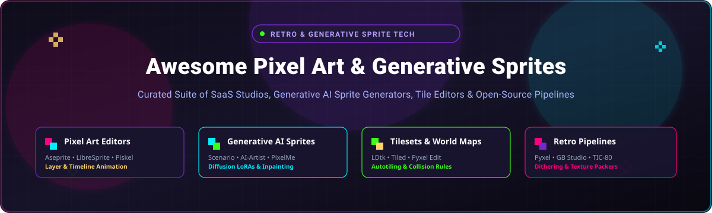

  

# 🎨 Awesome Pixel Art &amp; Generative Sprite Design 🕹️✨

### A Curated Directory of SaaS Platforms, Generative AI Sprite Engines, Pixel Editors, Autotiling Toolkits, &amp; Open-Source Pipelines

---

## 📖 Overview &amp; SEO Summary

Welcome to the definitive, high-performance ecosystem guide for **Pixel Art creation, 2D game asset design, and Generative AI sprite generation**. Whether you are an indie game developer, retro game hacker, technical artist, or pixel illustrator, this curated directory highlights industry-grade commercial SaaS software, web apps, mobile painting suites, and battle-tested open-source repositories.

Key categories covered:
- 👾 **Pixel Art Editors &amp; Sprite Animators**: Cross-platform drawing suites supporting onion skinning, layer effects, indexed color palettes, and `.ase` sprite sheet exports.
- 🤖 **Generative AI Sprites &amp; Diffusion Models**: AI models and plugins designed specifically for consistent pixel art characters, LoRA weights, inpainting, and auto-palette quantization.
- 🗺️ **Tileset Builders &amp; Level Designers**: Modern orthogonal, isometric, and hexagonal map editors with autotiling and rule-based collision mapping.
- ⚡ **Asset Automation &amp; Texture Packers**: CLI utilities, dither shaders, and sprite packing engines for Phaser, Godot, Unity, Defold, and custom WebGL/C++ engines.

---

## 📈 Sector Overview &amp; Market Dynamics

The global pixel art and 2D game asset tooling market is estimated at **$1.8B – $2.4B** across indie creative software, mobile illustration apps, and generative 2D game asset pipelines, with a projected CAGR of **12.4%** through 2030 propelled by the indie gaming renaissance and generative AI adoption.

The sector is **moderately fragmented**: commercial standalone tools (like Aseprite, Pyxel Edit, and Pixaki) and community open-source suites (LibreSprite, Pixelorama, Tiled, and LDtk) dominate dedicated desktop creation workflows, while venture-backed generative AI platforms (such as Scenario) and high-speed web apps represent an emerging tier competing for automated game asset generation.

---

## 📑 Table of Contents

- [📈 Sector Overview &amp; Market Dynamics](#-sector-overview--market-dynamics)
- [☁️ SaaS &amp; Commercial Hosted Platforms](#️-saas--commercial-hosted-platforms)
- [💻 Open-Source GitHub Projects](#-open-source-github-projects)
- [🛠️ How to Contribute](#️-how-to-contribute)
- [⭐ Star History](#-star-history)
- [💖 Support &amp; Sponsorship](#-support--sponsorship)
- [📜 Disclaimer &amp; License](#-disclaimer--license)

---

## ☁️ SaaS &amp; Commercial Hosted Platforms

The table below presents commercial SaaS platforms, cloud studios, and desktop commercial distributions sorted in descending order by estimated company scale, revenue, or venture valuation.

| Rank | 🏢 Platform | 📝 Description | 💰 Starting Tier Price | 🎁 Free Tier / Free Trial Limits | 📊 Company Scale (Est. Valuation / Revenue) |
| :---: | :--- | :--- | :--- | :--- | :--- |
| **01** | **[Scenario.gg](https://scenario.com)** | Generative AI game-asset platform with custom style model training for consistent sprites, isometric tilesets, and game art. | **$15/month** (Starter Plan) | **50 daily generation credits**; personal/evaluation use only, throttled generation queue | **~$30M - $40M Est. Valuation** ($6M Seed raised from Play Ventures &amp; Founders Inc.) |
| **02** | **[Aseprite](https://aseprite.org)** | Industry-standard pixel art tool and animated sprite editor with official commercial binary installers, Steam cloud sync, and Lua extensions. | **$19.99 one-time** (Steam / Itch.io perpetual license) | **Free trial binary available** (saves/exports disabled; or compile full version free from open source code) | **~$18.2M+ Gross Revenue** (Igara Studio; bootstrapped, 40K+ GitHub_Stars, ~900K+ Steam units) |
| **03** | **[Pixilart](https://pixilart.com)** | Cloud-based pixel art drawing studio, community canvas, and animation suite featuring dither tools and social collaboration. | **$4.99/month** (Pixilart Pro) | **Free forever plan** with ads, standard community tools, capped stamps (50 max), and basic cloud storage | **~$3M - $5M Est. Valuation** (High-traffic ad-supported &amp; Pro subscription web platform) |
| **04** | **[Resprite](https://fengeon.com)** | Multi-platform professional pixel art &amp; sprite animation studio engineered for iPad, Android, macOS, and Windows with Apple Pencil pressure. | **$28.00 one-time** (Cross-platform storefront license) | **Free version on mobile app stores** with canvas dimension limitations and basic layer caps | **~$1.5M - $3M Est. Valuation** (Growing indie mobile &amp; Steam creative software vendor) |
| **05** | **[Pixaki](https://rizer.co)** | Dedicated commercial iPad pixel art studio featuring onion skinning, reference layers, isometric guides, and native `.ase` file export. | **$19.99 one-time** (Pixaki 4 Pro App Store purchase) | **14-day full feature trial** (via Pixaki Intro on iOS App Store before purchasing Pro unlock) | **~$1M - $2M Est. Valuation** (Rizer Studios; established niche iPadOS creative tool) |
| **06** | **[Pyxel Edit](https://pyxeledit.com)** | Specialized pixel art editor tailored for tileset creation, tile instance linking, and rapid 2D tilemap mockups. | **$9.00 one-time** (Perpetual beta license via Humble Widget) | **Free legacy version 0.4.3** permanently available (lacks advanced layer blending and tileset linking) | **~$1M - $1.5M Est. Revenue** (Bootstrapped indie software by Daniel Kvarfordt) |
| **07** | **[PixelMe](https://pixel-me.tokyo)** | AI-powered photo and avatar pixelation web service converting portraits into retro sprites and bead/cross-stitch patterns. | **$4.99/week** or **$29.99/year** (PixelMe Pro) | **Free web tier** without signup up to 128x128 resolution with watermarks and ads | **~$500K - $1M Est. Valuation** (Bootstrapped viral AI micro-SaaS) |
| **08** | **[Pixelart.com](https://pixelart.com)** | Browser-based photo-to-pixel converter and pattern generator offering indexed palettes for Perler, Hama, and Minecraft. | **$2.99 for 24h Pass** or **$4.99/month** (Pro Plan) | **Free forever browser plan** with max 25 MB image uploads, 256x256 grid limit, 1024px PNG download | **~$400K - $800K Est. Valuation** (Independent bootstrapped web creator utility) |
| **09** | **[Lospec](https://lospec.com)** | Online palette resource hub, pixel art tutorials, and browser-based lightweight pixel editor for low-spec artists. | **$1/month to $50/month** (Patreon Patron tiers) | **Free forever tools &amp; palette lists**; patron tiers unlock ad-free experience, profile badges, and higher API limits | **Community Funded** (~$2K - $4K MRR Patreon/Ko-fi crowd sponsorship) |
| **10** | **[Dottable](https://dottable.app)** | Mobile pixel art sketching app tailored for rapid sprite doodling, palette customization, and frame animation on touch devices. | **$3.99 one-time** (Ad-free Pro in-app upgrade) | **Free ad-supported plan** with up to 120x120 canvas size, multi-layer GIF export, and standard palettes | **Independent Micro-App** (&lt;$200K ARR solo developer project) |

---

## 💻 Open-Source GitHub Projects

Explore the top open-source pixel art tools, AI plugins, retro engines, and sprite generators. Ranked in descending order by GitHub Stars_Count.

| Rank | 📦 Project | 🌟 GitHub_Stars | 🏷️ Category | 📝 Description |
| :---: | :--- | :---: | :--- | :--- |
| **01** | **[Aseprite](https://github.com/aseprite/aseprite)** |  | Pixel Editor / Animator | Flagship animated sprite editor and pixel art tool for Windows, macOS, and Linux with Lua scripting and onion skinning. |
| **02** | **[Pyxel](https://github.com/kitao/pyxel)** |  | Retro Game Engine | Retro game development engine for Python inspired by PICO-8, featuring built-in 16-color pixel sprite and sound editors. |
| **03** | **[Tiled Map Editor](https://github.com/mapeditor/tiled)** |  | Level &amp; Tilemap Editor | Highly versatile 2D level editor supporting orthogonal, isometric, and hexagonal pixel art tilesets with collision data. |
| **04** | **[Piskel](https://github.com/piskelapp/piskel)** |  | Web Pixel Editor | Accessible open-source web and desktop sprite editor with real-time frame previews, onion skinning, and GIF/spritesheet export. |
| **05** | **[Pixelorama](https://github.com/Orama-Interactive/Pixelorama)** |  | Godot Pixel Studio | Open-source 2D sprite editor built on Godot Engine with custom brushes, cel animations, 3D layer support, and dithering. |
| **06** | **[GB Studio](https://github.com/chrismaltby/gb-studio)** |  | Retro Console Studio | Drag-and-drop retro game maker that generates authentic Game Boy ROMs with strict 4-color pixel art tile limitations. |
| **07** | **[LibreSprite](https://github.com/LibreSprite/LibreSprite)** |  | Pixel Editor / Animator | Fully free, GPLv2 community-driven animated sprite editor and pixel art tool forked from Aseprite. |
| **08** | **[TIC-80](https://github.com/nesbox/TIC-80)** |  | Fantasy Computer | Open-source fantasy console for making, playing, and sharing tiny retro games with built-in sprite and tile editors. |
| **09** | **[LDtk](https://github.com/deepnight/ldtk)** |  | Level Designer Toolkit | Modern 2D level designer from the creator of *Dead Cells*, featuring Aseprite file import and auto-tiling rules. |
| **10** | **[PixelIt](https://github.com/giventofly/pixelit)** |  | JS Quantization Library | Lightweight JavaScript image-to-pixel-art converter library applying custom color palettes, block sizing, and dithering. |
| **11** | **[Vengi Voxel Engine](https://github.com/vengi-voxel/vengi)** |  | 3D Voxel to Sprite | Open-source voxel tools, thumbnailer, and editor with isometric pixel art rendering and sprite generation. |
| **12** | **[Godot Aseprite Wizard](https://github.com/viniciusgerevini/godot-aseprite-wizard)** |  | Engine Integration | Godot plugin to seamlessly import `.ase`/`.aseprite` files as `AnimatedSprite2D`, `SpriteFrames`, and `AnimationPlayer`. |
| **13** | **[Free Texture Packer](https://github.com/odrick/free-tex-packer)** |  | Sprite Packing Tool | Cross-platform sprite sheet and texture atlas generator exporting to PixiJS, Phaser, Godot, Unity, JSON, and XML. |
| **14** | **[Aseprite AI Artist](https://github.com/with-pebbly/aseprite-ai-artist)** |  | Generative AI Plugin | Open-source AI copilot plugin for Aseprite that paints, inpaints, and ideates sprites directly inside your open canvas. |
| **15** | **[Pixel Sprite Generator](https://github.com/zfedoran/pixel-sprite-generator)** |  | Procedural Generator | Algorithmic procedural sprite generator creating retro 2D pixel art sprites using 2-dimensional mask arrays. |
| **16** | **[Didder](https://github.com/makew0rld/didder)** |  | Dithering CLI Pipeline | Fast and mathematically accurate command-line image dithering utility supporting Bayer, Floyd-Steinberg, and custom palettes. |
| **17** | **[Dither](https://github.com/makew0rld/dither)** |  | Go Color Library | High-speed Go library for color quantization, perceptual luminance dithering, and retro palette reduction. |
| **18** | **[ZzSprite](https://github.com/KilledByAPixel/ZzSprite)** |  | Procedural Generator | Tiny, deterministic procedural pixel art sprite generator in JavaScript for game jams and miniature retro titles. |
| **19** | **[Aseprite Clip](https://github.com/aseprite/clip)** |  | C++ Clipboard Library | Official cross-platform C++ library developed by the Aseprite team to copy and paste image bit-planes and clipboard contents. |
| **20** | **[HTML5 Pixel Sprite Gen](https://github.com/ArtBIT/pixel-sprite-generator)** |  | Procedural Generator | Interactive HTML5 procedural pixel sprite generator generating hundreds of customizable pixel spaceship and monster variations. |

---

## 🛠️ How to Contribute

We welcome additions, updates, and improvements from pixel artists, game engine developers, and AI researchers! 🎮

1. 🍴 **Fork the repository** on GitHub.
2. 🌿 **Create a feature branch**: `git checkout -b feature/new-pixel-tool`.
3. 📝 **Add or update an entry**: Ensure SaaS entries include verified starting tier prices, specific free tier limits, and estimated company scales. For Open-Source projects, provide the full repository path and official descriptions.
4. 🚀 **Submit a Pull Request** with a brief summary of the changes.

---

## ⭐ Star History

#

---

## 💖 Support &amp; Sponsorship

Thank you for visiting and using this curated directory! If this repository has helped your game development pipeline, creative projects, or pixel art workflow, please consider showing your support:

- ⭐ **Star this repository** to help others discover it across GitHub.
- 🍴 **Fork and share** the project with fellow indie devs, game artists, and retro gaming communities.
- ☕ **Buy a coffee &amp; support ongoing curation** via the **[GitHub Sponsor Dashboard](https://github.com/sponsors/ishandutta2007)**!

Your encouragement and sponsorship help keep this resource continuously maintained, fact-checked, and updated with cutting-edge tools. Thank you for your support! 🌟

---

## 📜 Disclaimer &amp; License

- This list is curated for educational and informational purposes. Product logos, trademarks, and brand names belong to their respective creators and entities.
- Generative AI tools often produce mixed pixel resolutions ("mixels") or blurry anti-aliased edges. Always pair generative AI tools with nearest-neighbor scaling, color-palette quantization, and manual pixel polish.
- Released under the [MIT License](https://opensource.org/licenses/MIT).

---

<b>Crafted with passion for pixel artists, indie game creators, and retro enthusiasts worldwide 👾🎮</b>

